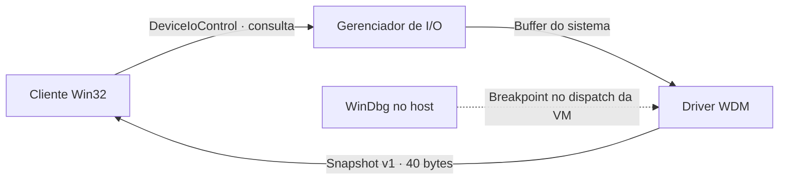

# BNQQ Kernel Telemetry

Driver de diagnóstico em **C++ para Windows x64** e cliente **Win32**. O cliente consulta o tempo de atividade do driver e os contadores de consultas aceitas e rejeitadas. O projeto é uma demonstração de comunicação entre modo usuário e modo kernel.



O driver cria um dispositivo de controle com acesso a **SYSTEM e administradores**. Expõe um único IOCTL de leitura com `METHOD_BUFFERED`, rejeita entrada extra e valida o tamanho do buffer. Um spin lock mantém os contadores e a resposta coerentes entre chamadas simultâneas. O contrato contém apenas números de versão, tempo e contadores do próprio driver.

## Painel BNQQ Driver Lab

Abra o atalho **BNQQ Driver Lab** na área de trabalho da VM. **Consultar driver** registra uma leitura. **Rodar teste de carga** executa 2.000 consultas concorrentes e duas leituras de controle. **Exportar relatório** grava em texto a saída das operações da sessão, inclusive os códigos de saída. Cada operação carrega o driver em um serviço temporário e o descarrega ao terminar.

Para montar o painel em outro convidado Hyper‑V já preparado para testes de drivers, coloque `panel/BNQQ-Driver-Lab.ps1`, `scripts/test-in-guest.ps1`, o cliente compilado `telemetry-client.exe` e o driver de teste assinado `BnqqKernelTelemetry.sys` na mesma pasta. Abra o painel pelo Windows PowerShell com privilégios de administrador.

O [wallpaper BNQQ System Engineering](panel/BNQQ-Wallpaper.png) acompanha o projeto. Para aplicá-lo ao usuário conectado no convidado, execute `panel/Set-LabWallpaper.ps1`. A opção `-LockInLab` mantém a imagem definida pela política de personalização desse usuário. Um administrador da VM pode reverter a política. Baixar o repositório ou o wallpaper não muda a área de trabalho.

| Campo | Tipo | Conteúdo |
| --- | --- | --- |
| `size`, `abi_version` | 2 × uint32 | Tamanho e versão do contrato |
| `uptime_100ns` | uint64 | Tempo desde que o dispositivo foi inicializado |
| `requests`, `succeeded`, `rejected` | 3 × uint64 | Contadores de IOCTL, incluindo a consulta atual |

## Compilar

Para o cliente e os testes, use CMake, MSVC e o Windows SDK. Em um prompt de desenvolvimento x64:

```powershell
cmake -S . -B build/client -A x64
cmake --build build/client --config Release
ctest --test-dir build/client -C Release --output-on-failure
```

Para o driver, use o SDK 26100 e os arquivos do pacote [Microsoft.Windows.WDK.x64 10.0.26100.6584](https://www.nuget.org/packages/Microsoft.Windows.WDK.x64/10.0.26100.6584). Extraia o pacote e aponte para a subpasta `c` que contém `Include` e `Lib`:

```powershell
.\scripts\build-driver.cmd "C:\WDK\c" "${env:ProgramFiles(x86)}\Windows Kits\10"
```

O build gera `build/driver/BnqqKernelTelemetry.sys` e seu PDB. O artefato local sai sem assinatura.

## Testar e depurar na VM

Em um convidado Windows preparado para drivers de teste, execute o roteiro com o driver assinado e o cliente:

```powershell
.\scripts\test-in-guest.ps1 -Driver C:\Lab\BnqqKernelTelemetry.sys -Client C:\Lab\telemetry-client.exe
```

O autoteste envia uma consulta válida, um IOCTL desconhecido, uma consulta com entrada indevida, uma com saída curta e uma consulta final para conferir os contadores. O [roteiro do WinDbg](docs/windbg.md) mostra como interromper a primeira requisição e comparar a estrutura em kernel com a saída no cliente.

Para rodar a carga na VM, use o mesmo script com `-Mode Stress`. O cliente abre oito conexões Win32 independentes e envia 2.000 consultas. Execute sem outros clientes conectados e sem breakpoint por requisição. O teste verifica a sequência de cada conexão e confere a contagem final.

## Validação desta versão

- **Verificado no Windows x64:** compilação e link do driver com MSVC/WDK, compilação do cliente Win32 e teste do contrato de telemetria via CTest.
- **Verificado no Hyper‑V:** o driver carregou em Windows Server 2025 x64, o cliente confirmou duas consultas aceitas e três rejeitadas, e o depurador capturou as cinco chamadas no kernel. O serviço foi parado e removido ao final. [Relatório da execução e evidências](docs/hyperv-validation.md)
- **Teste de concorrência no Hyper‑V:** 8 conexões, 2.000 consultas de carga e 2 leituras de controle. O driver registrou 2.002 aceitas e 0 rejeitadas. [Relatório da carga](docs/hyperv-validation.md#teste-de-carga-concorrente)

Referências: [segurança de objetos de dispositivo](https://learn.microsoft.com/en-us/windows-hardware/drivers/driversecurity/windows-security-model) e [configuração do KDNET](https://learn.microsoft.com/en-us/windows-hardware/drivers/debugger/setting-up-a-network-debugging-connection-automatically).
